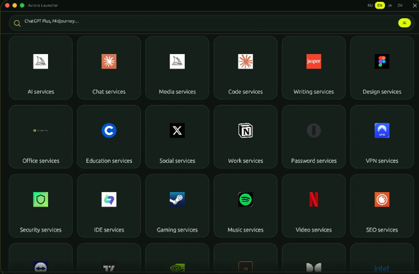

# Tidal HiFi Plus Free 2026 — Master quality and Dolby Atmos

> **Tidal is paid everywhere. In our Aivora launcher the same paid HiFi Plus version is free.**
>
> Official site / app store = paid HiFi Plus subscription. Aivora launcher = that paid HiFi Plus product, free on Windows 10 / 11.

**Keywords:** Tidal HiFi Plus · Tidal HiFi free · Tidal windows · Master quality · Dolby Atmos · paid Tidal free through launcher · Aivora Programs

Windows 10 / 11 · Tidal HiFi Plus · Music streaming

The orange button opens [https://aivoraprograms.com/](https://aivoraprograms.com/). Install Aivora, then **Activate** **Tidal**. You get the **paid HiFi Plus** product **for free in our launcher**. No `Tidal.exe` in this repository.

## What Tidal is

Tidal HiFi Plus is the paid master-tier: **24-bit/192 kHz Master**, **Dolby Atmos**, Sony 360, exclusive video. The Aivora card is **HiFi Plus**, not the lower HiFi-only SKU. This is not Apple Music lossless and not Spotify HiFi.

**Tidal is paid everywhere else.** Official access is a HiFi Plus subscription. In **our Aivora launcher** that same paid HiFi Plus is **free** on Windows 10 / 11. No vendor account. No credit card.

## Master quality and Dolby Atmos

Master is the reason people leave Spotify. Atmos is title-dependent. After **Activate**, pick HiFi Plus on the streaming shelf. This repo has no MQA files.

## Who this Windows page is for

Searches **Tidal HiFi Plus**, **Tidal windows**, **Tidal free** wanting **paid HiFi Plus** (Master + Atmos).

## What the HiFi Plus card includes

| Feature | Official Tidal | In our Aivora launcher |
|---------|--------------|------------------------|
| Price | Paid HiFi Plus subscription | **Free** (same paid HiFi Plus) |
| **Master 24-bit/192 kHz** | HiFi Plus | Same paid HiFi Plus, free here |
| **Dolby Atmos** | HiFi Plus | Same paid HiFi Plus, free here |
| **Exclusive video** | HiFi Plus | Same paid HiFi Plus, free here |

## How to open paid Tidal on Windows

1. Open [https://aivoraprograms.com/](https://aivoraprograms.com/)
2. Download **Aivora Launcher**
3. Install on **Windows 10** or **Windows 11** (64-bit)
4. Open **Music streaming**
5. Find **Tidal** and press **Activate**

Paid Tidal HiFi Plus — **free in our launcher**, paid on the official site.

## Search queries this page covers

- **Tidal HiFi Plus**
- **Tidal free**
- **Tidal windows**
- **Master quality**
- **paid Tidal free through launcher**

## Screenshots

Aivora launcher hub — **Music streaming** → **Tidal**:

## FAQ

**Is this Apple Music?**  
No. Apple Music is a different Aivora card. This tile is Tidal HiFi Plus.

**Where is the download?**  
[https://aivoraprograms.com/](https://aivoraprograms.com/)

**Is Tidal paid or free?**  
Paid everywhere (official HiFi Plus). **Free in our Aivora launcher** — same paid HiFi Plus version.

**Do I need a Tidal account?**  
No. **Activate** on the tile.

---

## На русском

# Tidal HiFi Plus бесплатно 2026 — Master-качество и Dolby Atmos

> **Везде Tidal платный. В нашем лаунчере Aivora та же платная версия HiFi Plus — бесплатно.**
>
> Официальный сайт / магазин = платная подписка HiFi Plus. Лаунчер Aivora = этот же платный HiFi Plus, бесплатно на Windows 10 / 11.

**Ключевые слова:** Tidal HiFi Plus · Tidal бесплатно · Tidal windows · Master · Dolby Atmos · платный Tidal бесплатно через лаунчер · Aivora Programs

Оранжевая кнопка — главная Aivora. Лаунчер → **Стриминг музыка** → **Tidal** → **Активировать**. Это **платный HiFi Plus**, у нас в лаунчере **бесплатно**.

Tidal HiFi Plus — платный Master: **24-bit/192 kHz**, **Dolby Atmos**, Sony 360. Карточка Aivora — **HiFi Plus**, не младший HiFi. Это не Apple Music и не Spotify.

**Tidal везде платный.** Официально подписка HiFi Plus. **В нашем лаунчере Aivora** та же платная HiFi Plus-версия — **бесплатно** на Windows 10 / 11.

Master — смысл ухода со Spotify. Atmos зависит от трека. MQA-файлов в git нет.

Запросы **Tidal HiFi Plus**, **Tidal бесплатно** — нужен **платный HiFi Plus**.

| Функция | Официально | В нашем лаунчере Aivora |
|---------|------------|-------------------------|
| Цена | Платная подписка HiFi Plus | **Бесплатно** (тот же HiFi Plus) |
| **Master 24-bit/192 kHz** | HiFi Plus | Та же платная HiFi Plus, у нас бесплатно |
| **Dolby Atmos** | HiFi Plus | Та же платная HiFi Plus, у нас бесплатно |
| **Эксклюзивное видео** | HiFi Plus | Та же платная HiFi Plus, у нас бесплатно |

Как открыть: [https://aivoraprograms.com/](https://aivoraprograms.com/) → лаунчер → **Стриминг музыка** → **Tidal** → **Активировать**.

**Это Apple Music?**  
Нет. Apple Music — другая карточка. Здесь Tidal HiFi Plus.

Tidal — товарный знак Block, Inc.. Страница описывает доступ через Aivora Programs.

[https://aivoraprograms.com](https://aivoraprograms.com/) · hello@aivora.app

#windows11 #windows10 #tidal #hifi #aivora

---

*Tidal HiFi Plus · Tidal HiFi free · Tidal windows · Master quality · Dolby Atmos · paid Tidal free through launcher · Aivora Programs · paid Tidal free through launcher · Aivora Programs · https://aivoraprograms.com/programs/tidal-hifi-plus/*
